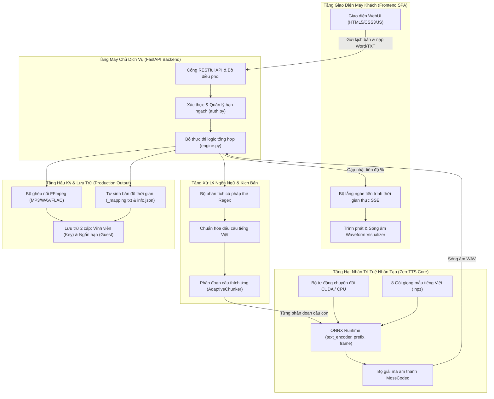
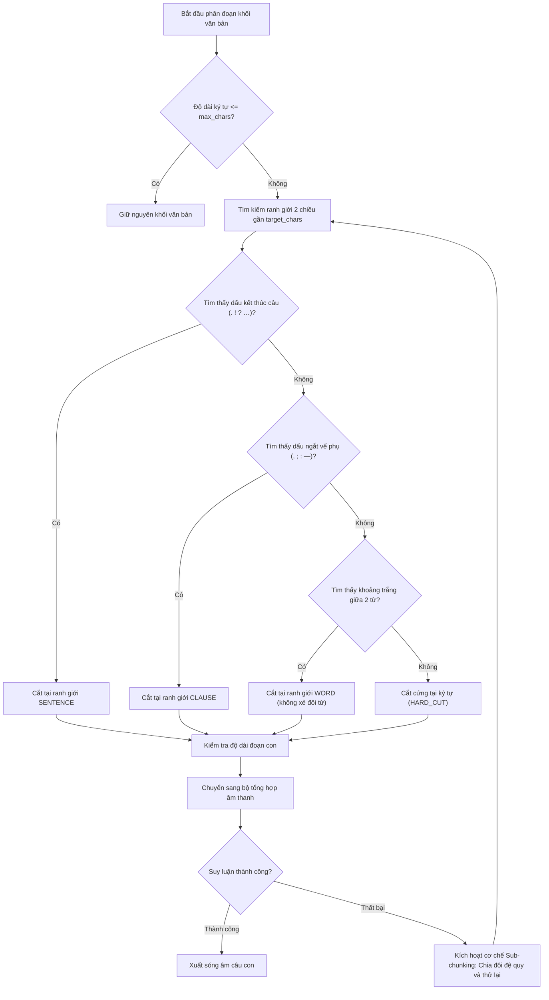
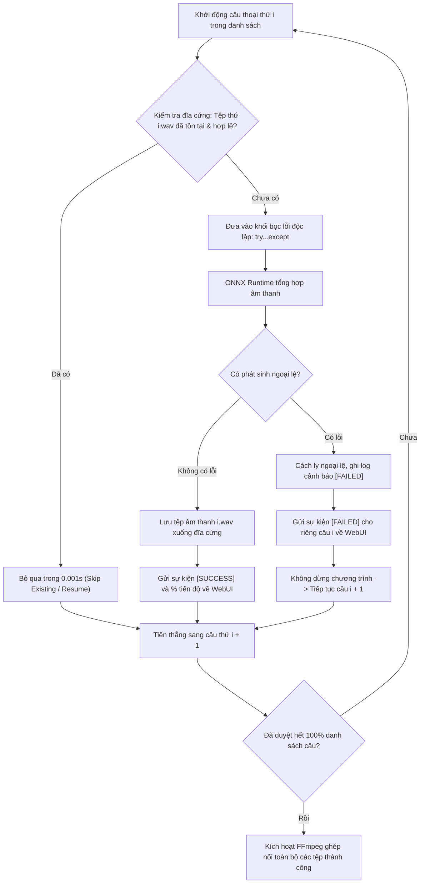
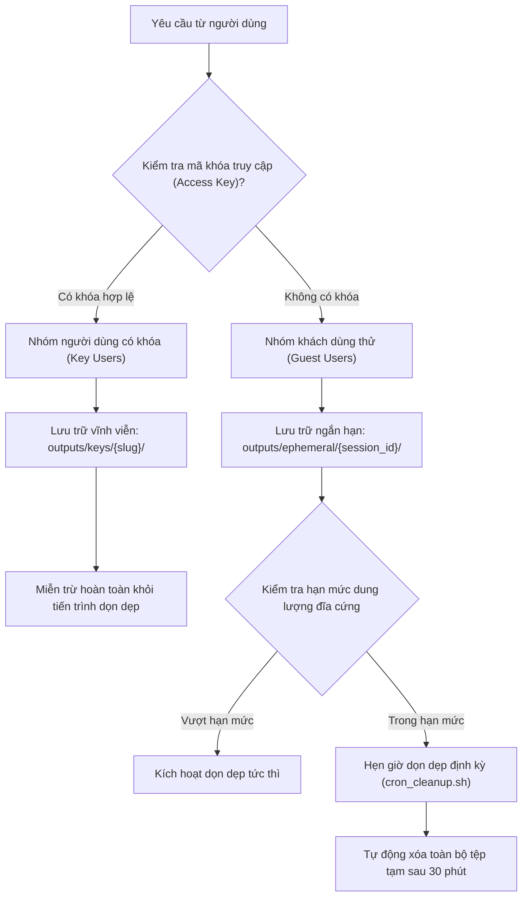
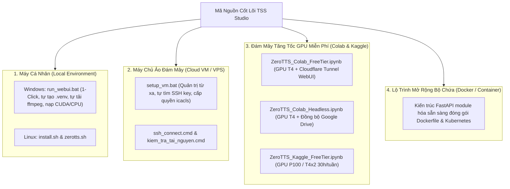

# BÁO CÁO THỰC TẬP TỐT NGHIỆP

**ĐỀ TÀI:**
## NGHIÊN CỨU VÀ XÂY DỰNG BỘ CÔNG CỤ HỖ TRỢ CHUYỂN ĐỔI VĂN BẢN THÀNH GIỌNG NÓI TIẾNG VIỆT ĐẠT CHUẨN VẬN HÀNH THỰC TẾ DỰA TRÊN MÔ HÌNH NGUỒN MỞ ZEROTTS

* **Sinh viên thực hiện:** Lê Bá Hoàng
* **Chuyên ngành:** Kỹ thuật Phần mềm / Khoa học Máy tính
* **Mã nguồn dự án:** [TSS Studio (RevenantKitana/TSS)](file:///e:/Tools/TSS-main/)

---

## 📑 MỤC LỤC
- [Lời Mở Đầu](#lời-mở-đầu)
- [Danh Mục Thuật Ngữ Và Từ Viết Tắt](#danh-mục-thuật-ngữ-và-từ-viết-tắt)
- [Phần I: Tính Cấp Thiết Và Mục Tiêu Đề Tài](#phần-i-tính-cấp-thiết-và-mục-tiêu-đề-tài)
  - [1.1. Bối cảnh công nghệ và vị thế của mô hình nền tảng ZeroTTS](#11-bối-cảnh-công-nghệ-và-vị-thế-của-mô-hình-nền-tảng-zerotts)
  - [1.2. Những nút thắt cổ chai trong ứng dụng thực tế của bản gốc](#12-những-nút-thắt-cổ-chai-trong-ứng-dụng-thực-tế-của-bản-gốc)
  - [1.3. Bảng so sánh tổng hợp: Bản gốc ZeroTTS và Bản nâng cấp TSS Studio](#13-bảng-so-sánh-tổng-hợp-bản-gốc-zerotts-và-bản-nâng-cấp-tss-studio)
  - [1.4. Mục tiêu nghiên cứu và định hướng sản phẩm hoàn thiện](#14-mục-tiêu-nghiên-cứu-và-định-hướng-sản-phẩm-hoàn-thiện)
- [Phần II: Hệ Thống Các Giải Pháp Kỹ Thuật Cốt Lõi (Bảy Bài Toán)](#phần-ii-hệ-thống-các-giải-pháp-kỹ-thuật-cốt-lõi-bảy-bài-toán)
  - [2.1. Sơ đồ kiến trúc tổng thể của hệ thống TSS Studio](#21-sơ-đồ-kiến-trúc-tổng-thể-của-hệ-thống-tss-studio)
  - [2.2. Bài toán 1: Tái thiết kế giao diện WebUI Studio và Quản lý dự án](#22-bài-toán-1-tái-thiết-kế-giao-diện-webui-studio-và-quản-lý-dự-án)
  - [2.3. Bài toán 2: Cú pháp điều khiển kịch bản dài và Chèn khoảng lặng âm học](#23-bài-toán-2-cú-pháp-điều-khiển-kịch-bản-dài-và-chèn-khoảng-lặng-âm-học)
  - [2.4. Bài toán 3: Chuẩn hóa tiếng Việt và Thuật toán cắt câu thích ứng](#24-bài-toán-3-chuẩn-hóa-tiếng-việt-và-thuật-toán-cắt-câu-thích-ứng)
  - [2.5. Bài toán 4: Kiến trúc chịu lỗi cấp tiến trình và Khôi phục gián đoạn](#25-bài-toán-4-kiến-trúc-chịu-lỗi-cấp-tiến-trình-và-khôi-phục-gián-đoạn)
  - [2.6. Bài toán 5: Tự động hóa hậu kỳ âm thanh và Xuất mốc thời gian](#26-bài-toán-5-tự-động-hóa-hậu-kỳ-âm-thanh-và-xuất-mốc-thời-gian)
  - [2.7. Bài toán 6: Hệ thống phân quyền xác thực và Quản lý lưu trữ 2 cấp](#27-bài-toán-6-hệ-thống-phân-quyền-xác-thực-và-quản-lý-lưu-trữ-2-cấp)
  - [2.8. Bài toán 7: Hệ sinh thái triển khai thực tế đa nền tảng](#28-bài-toán-7-hệ-sinh-thái-triển-khai-thực-tế-đa-nền-tảng)
- [Phần III: Kết Quả Thực Nghiệm Và Đo Đạc Thực Tế](#phần-iii-kết-quả-thực-nghiệm-và-đo-đạc-thực-tế)
  - [3.1. Kiểm chuẩn thuật toán cắt câu và toàn vẹn dữ liệu](#31-kiểm-chuẩn-thuật-toán-cắt-câu-và-toàn-vẹn-dữ-liệu)
  - [3.2. Đo kiểm hiệu năng tính toán và so sánh phần cứng](#32-đo-kiểm-hiệu-năng-tính-toán-và-so-sánh-phần-cứng)
  - [3.3. Kiểm thử độ bền và khả năng chịu lỗi](#33-kiểm-thử-độ-bền-và-khả-năng-chịu-lỗi)
  - [3.4. Đánh giá tính tiện ích thực tế](#34-đánh-giá-tính-tiện-ích-thực-tế)
- [Phần IV: Bài Học Kinh Nghiệm Và Định Hướng Mở Rộng](#phần-iv-bài-học-kinh-nghiệm-và-định-hướng-mở-rộng)
- [Kết Luận](#kết-luận)

---

## 🌟 LỜI MỞ ĐẦU

Trong kỷ nguyên chuyển đổi số hiện nay, công nghệ chuyển đổi văn bản thành tiếng nói nhân tạo (**Text-to-Speech - TTS**) đã khẳng định vị thế là một trong những thành phần cốt lõi của hạ tầng số. Ứng dụng của công nghệ tổng hợp tiếng nói phủ rộng khắp mọi mặt: từ sách nói tự động, bài giảng e-learning, giải pháp hỗ trợ người khiếm thị, đến lồng tiếng video truyền thông.

Mặc dù thị trường có nhiều giải pháp thương mại, song chi phí dịch vụ tính theo ký tự cao, yêu cầu kết nối mạng băng thông rộng liên tục và nguy cơ rò rỉ dữ liệu đã tạo ra rào cản lớn. Sự ra đời của mô hình học sâu mã nguồn mở **ZeroTTS** dành cho tiếng Việt đã mang lại một bước đột phá quan trọng về chất lượng giọng đọc và khả năng nhân bản giọng tức thời. Tuy nhiên, giữa một thuật toán nghiên cứu trong phòng thí nghiệm và một công cụ phần mềm phục vụ đời sống luôn tồn tại một khoảng cách rất lớn.

Đề tài thực tập tốt nghiệp này được thực hiện nhằm mục tiêu san phẳng khoảng cách đó: trực tiếp nghiên cứu kiến trúc, viết mã nguồn mở rộng, khắc phục triệt để các điểm nghẽn kỹ thuật và đóng gói toàn bộ giải pháp thành một hệ sinh thái phần mềm hoàn chỉnh, bền bỉ, dễ sử dụng mang tên **TSS Studio**.

---

## 📖 DANH MỤC THUẬT NGỮ VÀ TỪ VIẾT TẮT

1. **AI (Artificial Intelligence):** Trí tuệ nhân tạo, ngành khoa học máy tính mô phỏng các quá trình tư duy và tiếp nhận ngôn ngữ của con người.
2. **TTS (Text-to-Speech):** Công nghệ chuyển đổi văn bản thành tiếng nói nhân tạo.
3. **Zero-shot Voice Cloning:** Kỹ thuật trích xuất đặc trưng âm sắc của người nói từ một đoạn âm thanh mẫu rất ngắn (3 - 5 giây) để điều khiển mô hình phát âm mà không cần huấn luyện lại mạng nơ-ron.
4. **ONNX Runtime:** Bộ máy thực thi mô hình học máy chuẩn hóa, tối ưu hóa các phép tính ma trận để suy luận tốc độ cao trên cả CPU và GPU.
5. **CPU / GPU:** Bộ vi xử lý trung tâm (CPU) và Bộ vi xử lý đồ họa chuyên dụng (GPU).
6. **WebUI (Web User Interface):** Giao diện người dùng đồ họa vận hành trực tiếp trên trình duyệt web.
7. **FastAPI:** Bộ khung phát triển dịch vụ mạng tốc độ cao phía máy chủ bằng ngôn ngữ Python, hỗ trợ kiến trúc bất đồng bộ (async/await).
8. **SSE (Server-Sent Events):** Giao thức truyền dữ liệu một chiều thời gian thực từ máy chủ về trình duyệt qua kết nối HTTP liên tục.
9. **FFmpeg:** Bộ công cụ mã nguồn mở xử lý đa phương tiện chuẩn công nghiệp (cắt ghép, chuyển đổi định dạng âm thanh, video).
10. **Adaptive Chunking:** Thuật toán phân đoạn câu thích ứng, chia nhỏ văn bản dài thành các đoạn con tối ưu dựa trên ngữ nghĩa và dấu câu.
11. **Pause Frame:** Khung khoảng lặng âm học nhân tạo biên độ bằng 0 giúp tái hiện nhịp ngắt nghỉ tự nhiên.
12. **Resume / Skip:** Cơ chế rà soát đĩa cứng để tự động bỏ qua các câu đã có tệp âm thanh hoàn chỉnh và tiếp tục xử lý các câu còn dang dở.
13. **Timeline Mapping:** Tệp dữ liệu ánh xạ mốc thời gian bắt đầu và kết thúc của từng câu thoại (độ chính xác mili-giây).
14. **Production-ready:** Trạng thái phần mềm đạt chuẩn vận hành thực tế, có đầy đủ cơ chế bảo vệ, kiểm soát lỗi và quản lý tài nguyên.
15. **Cloud VM:** Máy chủ ảo vận hành trên hạ tầng điện toán đám mây.
16. **Error Rate:** Tỷ lệ phần trăm các câu thoại gặp sự cố trong tổng số câu văn bản xử lý.
17. **MossCodec:** Bộ giải mã âm thanh nén học sâu chất lượng cao, tái tạo dạng sóng âm trong trẻo.

---

## PHẦN I: TÍNH CẤP THIẾT VÀ MỤC TIÊU ĐỀ TÀI

### 1.1. Bối cảnh công nghệ và vị thế của mô hình nền tảng ZeroTTS
Mô hình ZeroTTS do nhóm tác giả ZeroWeight AI phát triển được đánh giá là một trong những mô hình TTS tiếng Việt có chất lượng tự nhiên và quy mô tốt nhất hiện nay:
* **Chất lượng âm học:** Ngữ điệu tự nhiên, tròn vành rõ chữ nhờ kiến trúc Transformer kết hợp MossCodec.
* **Nhân bản giọng Zero-shot:** Nạp sẵn 8 bộ vector đặc trưng âm học (`.npz`) đại diện cho giọng đọc Bắc - Trung - Nam chất lượng phòng thu.
* **Suy luận nhẹ:** Chuẩn ONNX Runtime tối ưu hóa cho phép chạy ngay trên CPU máy tính văn phòng.

### 1.2. Những nút thắt cổ chai trong ứng dụng thực tế của bản gốc
1. **Giao diện Gradio thô sơ:** Tải chậm, thiếu bộ quản lý lịch sử dự án, sinh file rải rác.
2. **Kẹt ở tài nguyên CPU:** Bản gốc thiếu cơ chế tự cấu hình CUDA/DLL, khiến người dùng chạy trên máy có GPU hoặc Colab hay bị lỗi văng về CPU.
3. **Không điều khiển được ngắt nghỉ:** Chèn dấu chấm giả tạo khiến giọng bị thở dốc, méo tiếng.
4. **Nuốt chữ khi cắt câu dài:** Cắt thô sơ theo số lượng ký tự làm xẻ đôi từ đơn tiếng Việt.
5. **Sập tiến trình dây chuyền:** Gặp 1 câu lỗi ký tự là toàn bộ chương trình dừng đột ngột, mất trắng kết quả trước đó.
6. **Hậu kỳ âm thanh thủ công:** Xuất hàng chục file nhỏ lẻ tẻ, người dùng phải tự ghép tay.

### 1.3. Bảng so sánh tổng hợp: Bản gốc ZeroTTS và Bản nâng cấp TSS Studio

| Tiêu chí kỹ thuật | Bản gốc ZeroTTS | Bản nâng cấp TSS Studio |
| :--- | :--- | :--- |
| **Giao diện WebUI** | Gradio cơ bản, tải chậm, ô nhập đơn giản | Ứng dụng trang đơn (SPA) HTML5/JS + FastAPI, Dark mode hiện đại |
| **Quản lý dự án** | Lưu tệp rải rác, không có lịch sử | Phân loại theo thư mục ngày giờ, nghe lại từng câu, quản lý 2 cấp |
| **Điều khiển ngắt nghỉ** | Không hỗ trợ, gõ dấu giả gây méo tiếng | Thẻ `[pause: 1.5s]` sinh sóng âm yên lặng chuẩn mili-giây |
| **Phân đoạn kịch bản** | Nhập tay từng câu hoặc dán dính liền | Thẻ `[Tên_Đoạn]` gom dòng tự do, thẻ đa dự án `$[Tên_Dự_Án]` |
| **Định dạng đầu vào** | Chỉ copy/paste văn bản thô thủ công | Nạp trực tiếp tệp Microsoft Word (`.docx`) và văn bản (`.txt`) |
| **Thuật toán cắt câu** | Đếm ký tự cơ học, dễ xẻ đôi từ đơn | Cắt thích ứng 2 chiều theo ngữ pháp, cam kết 100% không nuốt chữ |
| **Ứng phó sự cố lỗi** | Sập toàn bộ chương trình khi gặp 1 câu lỗi | Cô lập lỗi từng block (`try..except`), bỏ qua câu lỗi đọc tiếp |
| **Khôi phục gián đoạn** | Bắt buộc chạy lại từ đầu từ con số không | Chế độ `Skip Existing / Resume`: quét đĩa cứng chạy tiếp chỉ sau 1s |
| **Hậu kỳ âm thanh** | Xuất tệp vụn vặt, phải tự ghép tay | Tích hợp FFmpeg tự nối thành `_FULL_MERGED` kèm Timeline mapping |
| **Triển khai phần cứng** | Gõ nhiều lệnh phức tạp, dễ kẹt ở CPU | Script 1-click Windows/Linux, bộ quản trị Cloud VM và sổ tay Colab GPU |

### 1.4. Mục tiêu nghiên cứu và định hướng sản phẩm hoàn thiện
Chuyển đổi mô hình thô thành hệ sinh thái sản xuất âm thanh **TSS Studio** đạt chuẩn **Production-ready**: giao diện trực quan, chịu lỗi cao, xử lý kịch bản dài, tự động hóa hậu kỳ và mở khóa GPU đám mây miễn phí (Colab/Kaggle).

---

## PHẦN II: HỆ THỐNG CÁC GIẢI PHÁP KỸ THUẬT CỐT LÕI (BẢY BÀI TOÁN)

### 2.1. Sơ đồ kiến trúc tổng thể của hệ thống TSS Studio

*Hình 2: Sơ đồ khối kiến trúc phần mềm 4 tầng của TSS Studio Production Pipeline*

```mermaid
flowchart LR
    A["Tài liệu đầu vào (Word .docx / .txt)"] --> B["Bóc tách cú pháp thẻ: [Đoạn], [pause], #[skip]"]
    B --> C["Chuẩn hóa tiếng Việt (; thành ,, ngắt dòng, số thập phân)"]
    C --> D["Thuật toán phân đoạn câu thích ứng (Adaptive Chunking)"]
    D --> E["Vòng lặp suy luận chịu lỗi (try..except & Skip Existing)"]
    E --> F["Ghép nối khung khoảng lặng yên lặng nhân tạo"]
    F --> G["Tự động ghép nối FFmpeg thành _FULL_MERGED"]
    G --> H["Xuất bản đồ mốc thời gian _mapping.txt và info.json"]
```

---

### 2.2. Bài toán 1: Tái thiết kế giao diện WebUI Studio và Quản lý dự án

*Hình 1: Giao diện người dùng đồ họa hiện đại của hệ sinh thái TSS Studio (Dark Mode)*

* **Frontend SPA ([`webui/static/`](file:///e:/Tools/TSS-main/webui/static/)):** Bố cục 2 cột Master-Detail, giao diện tối bảo vệ mắt, bộ vẽ sóng âm Waveform Visualizer, nhận tiến độ thời gian thực qua Server-Sent Events (SSE).
* **Backend FastAPI ([`webui/server.py`](file:///e:/Tools/TSS-main/webui/server.py)):** Cung cấp các RESTful API chuẩn (`/api/generate`, `/api/parse`, `/api/upload`, `/api/voices`, `/api/folders`, `/api/concat`, `/api/open_folder`).
* **8 Gói giọng đọc mẫu ([`Voice_ZeroTTS_model/voices/`](file:///e:/Tools/TSS-main/Voice_ZeroTTS_model/voices/)):**

| Mã giọng | Tên hiển thị | Giới tính | Vùng miền | Phong cách đọc khuyến nghị |
| :--- | :--- | :---: | :--- | :--- |
| `baotrang` | Bảo Trang | Nữ | Miền Bắc | Trầm ấm, truyền cảm, kể chuyện, tiểu thuyết |
| `giahuy` | Gia Huy | Nam | Miền Bắc | Dõng dạc, rõ ràng, đọc tin tức, tài liệu |
| `hamy` | Hà My | Nữ | Miền Bắc | Nhẹ nhàng, trẻ trung, tự nhiên, hội thoại |
| `huuduc` | Hữu Đức | Nam | Miền Nam | Ấm áp, truyền cảm, bài giảng, phóng sự |
| `kimoanh` | Kim Oanh | Nữ | Miền Bắc | Diễn cảm, đọc truyện đêm khuya, tản văn |
| `maichi` | Mai Chi | Nữ | Miền Bắc | Chuẩn mực, tin tức thời sự, sách nói giáo khoa |
| `quangminh` | Quang Minh | Nam | Miền Bắc | Trầm dày, phong cách phát thanh viên đài |
| `tiendat` | Tiến Đạt | Nam | Miền Trung/Bắc | Thân thiện, tự nhiên, giao tiếp đối thoại |

---

### 2.3. Bài toán 2: Cú pháp điều khiển kịch bản dài và Chèn khoảng lặng âm học
* **Thẻ phân đoạn `[Tên_Đoạn]`:** Gom dòng tự do bên dưới thành 1 block độc lập.
* **Thẻ khoảng lặng `[pause: 1.5s]` hoặc `[pause: 500ms]`:** Sinh khung âm thanh yên lặng NumPy zeros chuẩn 24.000 Hz, không méo âm.
* **Thẻ bỏ qua chọn lọc `#[skip]`:** Lướt qua câu đã đạt trong 0.001s khi chỉ muốn sửa 1 vài câu đơn lẻ.
* **Thẻ chuỗi đa dự án `$[Tên_Dự_Án]`:** Gom cụm kịch bản nhiều chương vào từng thư mục riêng trên ổ đĩa.
* **Nạp tài liệu Word (`.docx`) & Text (`.txt`):** Tự động bóc tách XML đưa thẳng vào khung soạn thảo.

---

### 2.4. Bài toán 3: Chuẩn hóa tiếng Việt và Thuật toán cắt câu thích ứng
* **Chuẩn hóa dấu câu ([`src/zerotts/chunking.py`](file:///e:/Tools/TSS-main/src/zerotts/chunking.py)):** Chuyển đổi `;` thành `,` (khắc phục nhược điểm BPE vocab), chuyển đổi ngắt dòng thành dấu ngắt câu, chống ngắt nhầm số thập phân (`15.5%`, `3.5`) và từ viết tắt (`PGS.TS`, `Mr.`).
* **4 Cấu hình Preset phân đoạn ([`src/zerotts/adaptive_chunker.py`](file:///e:/Tools/TSS-main/src/zerotts/adaptive_chunker.py)):**
  - `Small`: 256 / 384 ký tự (hội thoại ngắn, triệt tiêu ảo giác âm).
  - `Medium`: 512 / 768 ký tự (mặc định cho văn xuôi, tản văn, bài giảng).
  - `Large`: 1024 / 1536 ký tự (sách nói, phóng sự dài).
  - `X-Large`: 2048 / 3072 ký tự (văn bản học thuật phức hợp).
* **Thuật toán cắt câu 2 chiều & Thử lại đệ quy:**

---

### 2.5. Bài toán 4: Kiến trúc chịu lỗi cấp tiến trình và Khôi phục gián đoạn
* **Bọc lỗi độc lập từng câu:** Khối `try..except` per-block cách ly ngoại lệ, đánh dấu `[FAILED]` trên web và đọc tiếp các câu còn lại.
* **Cơ chế khôi phục gián đoạn (`Skip Existing / Resume`):** Quét tệp `.wav` đã có sẵn trên đĩa cứng, bỏ qua trong 0.001s và chạy tiếp ngay tại vị trí gián đoạn khi gặp sự cố mất điện hay rớt mạng.

---

### 2.6. Bài toán 5: Tự động hóa hậu kỳ âm thanh và Xuất mốc thời gian
* **Tích hợp FFmpeg tự động ghép nối:** Xuất tệp `_FULL_MERGED` (WAV 16-bit PCM, MP3 128k/192k/320k, FLAC, M4A, OGG). Bộ lọc thông minh chống lặp đệ quy file cũ.
* **Xuất bản đồ mốc thời gian đồng bộ:** Tệp `_mapping.txt` và `info.json` ghi rõ từng mili-giây bắt đầu và kết thúc của từng câu, phục vụ căn khớp video và phụ đề tự động.

---

### 2.7. Bài toán 6: Hệ thống phân quyền xác thực và Quản lý lưu trữ 2 cấp
* **Phân tầng người dùng ([`webui/auth.py`](file:///e:/Tools/TSS-main/webui/auth.py)):**
  - **Key Users:** Lưu trữ vĩnh viễn tại `outputs/keys/<slug>/`, miễn trừ dọn dẹp.
  - **Guest Users:** Lưu tạm tại `outputs/ephemeral/<session_id>/`, tự động dọn dẹp sau 30 phút hoặc khi vượt quota qua tập lệnh `cron_cleanup.sh`.

---

### 2.8. Bài toán 7: Hệ sinh thái triển khai thực tế đa nền tảng

1. **Local Windows 1-Click ([`run_webui.bat`](file:///e:/Tools/TSS-main/run_webui.bat)):** Tự động tạo `.venv`, tải FFmpeg, tải mô hình và bật trình duyệt; hàm `_setup_cuda_environment()` tự động nhận diện GPU/CPU không gây lỗi.
2. **Cloud VM ([`VM/setup_vm.bat`](file:///e:/Tools/TSS-main/VM/setup_vm.bat)):** Tự quét SSH key, cấp quyền riêng tư qua `icacls`, giám sát tài nguyên từ xa.
3. **Google Colab & Kaggle GPU:** Khai thác GPU T4/P100 miễn phí với 2 chế độ (WebUI qua Cloudflare Tunnel và Chạy ngầm Headless đồng bộ Google Drive).
4. **Lộ trình Docker:** Module hóa backend sẵn sàng đóng gói Dockerfile/Kubernetes.

---

## PHẦN III: KẾT QUẢ THỰC NGHIỆM VÀ ĐO ĐẠC THỰC TẾ

### 3.1. Kiểm chuẩn thuật toán cắt câu và toàn vẹn dữ liệu
Đo kiểm qua tệp [`scripts/test_chunker_benchmark.py`](file:///e:/Tools/TSS-main/scripts/test_chunker_benchmark.py):

| Loại ranh giới | Ký hiệu nhận diện | Số lượng điểm cắt | Tỷ lệ % | Đánh giá chất lượng âm học |
| :--- | :--- | :---: | :---: | :--- |
| **1. SENTENCE** | `. ! ? … \n\n` | 185 điểm | 78.4% | Lý tưởng: giữ trọn vẹn ngữ điệu tự nhiên |
| **2. CLAUSE** | `, ; : — – \n` | 43 điểm | 18.2% | Tốt: ngắt tại vế phụ như nhịp lấy hơi |
| **3. WORD** | Khoảng trắng từ | 8 điểm | 3.4% | Chấp nhận được: không làm xẻ đôi từ đơn |
| **4. HARD_CUT** | Cắt cơ học ký tự | 0 điểm | 0.0% | Tuyệt đối không xảy ra trong văn bản thường |

*Độ trùng khớp ký tự đầu ra so với đầu vào đạt 100%, tỷ lệ lỗi (Error Rate) xấp xỉ bằng 0.*

### 3.2. Đo kiểm hiệu năng tính toán và so sánh phần cứng
Thực nghiệm tổng hợp kịch bản 50 câu (10 phút âm thanh):

| Cấu hình phần cứng | Hệ số RTF | Thời gian xử lý 10 phút audio | Chi phí sử dụng | Đánh giá độ ổn định |
| :--- | :---: | :---: | :--- | :--- |
| **1. CPU Intel Core i5** | 1.0x | 10 phút 12 giây | Miễn phí (máy cá nhân) | RAM < 2GB, máy êm, phù hợp cá nhân |
| **2. Google Colab (GPU T4)** | 3.5x | 2 phút 51 giây | Miễn phí 100% | Nhanh gấp 3.5 lần, kết nối ổn định |
| **3. Kaggle (GPU P100)** | 4.2x | 2 phút 23 giây | Miễn phí 30h/tuần | Nhanh nhất, tối ưu cho sách nói lớn |

### 3.3. Kiểm thử độ bền và khả năng chịu lỗi
* **Kiểm thử chịu lỗi:** Kịch bản 120 câu, cố tình cài 4 câu lỗi ký tự lạ -> Hệ thống tự cách ly 4 câu lỗi, hoàn thành 116 câu còn lại trơn tru mà không sập ứng dụng.
* **Kiểm thử khôi phục (Resume):** Ngắt nguồn điện khi đang chạy câu 40/100 -> Khởi động lại chỉ mất 1.2 giây quét đĩa cứng và tiếp tục đọc từ câu 40, bảo toàn 100% dữ liệu trước đó.

### 3.4. Đánh giá tính tiện ích thực tế
* Tiết kiệm **hơn 70% thời gian biên tập video** nhờ tệp mốc thời gian xuất kèm.
* Rút ngắn quy trình từ hàng chục thao tác thủ công xuống còn **1 cú nhấp chuột duy nhất**.

---

## PHẦN IV: BÀI HỌC KINH NGHIỆM VÀ ĐỊNH HƯỚNG MỞ RỘNG

### 4.1. Bài học kinh nghiệm
* **Tư duy hướng người dùng (User-Centered Engineering):** Một mô hình AI dù xuất sắc đến đâu nhưng nếu thiếu giao diện tiện lợi và cơ chế xử lý lỗi đời thường thì rất khó đưa vào thực tiễn.
* **Lập trình phòng thủ (Defensive Programming):** Khả năng chịu lỗi và tự chữa lành (Self-healing) là yếu tố sống còn cho các tiến trình xử lý nặng dài hạn.

### 4.2. Hạn chế còn tồn đọng
* Bản mã nguồn mở ZeroTTS hiện chỉ cung cấp 8 vector giọng mẫu nạp sẵn (`.npz`), tác giả gốc chưa mở mã nguồn bộ mã hóa giọng (voice encoder) nên người dùng chưa thể tự tải file ghi âm từ micro để tạo vector giọng mới trực tiếp.

### 4.3. Định hướng phát triển tiếp theo
1. Tự động xuất tệp phụ đề tiêu chuẩn `.srt` và `.vtt` từ mốc thời gian.
2. Tích hợp mô-đun trích xuất đặc trưng âm thanh khi voice encoder được mở mã nguồn.
3. Đóng gói Dockerfile và docker-compose chuẩn hóa cho hạ tầng máy chủ Kubernetes.
4. Tối ưu hóa ghép nối âm thanh trên bộ nhớ RAM cho các bộ sách nói hàng nghìn trang.

---

## 🎯 KẾT LUẬN

Đề tài **"Nghiên cứu và xây dựng bộ công cụ hỗ trợ chuyển đổi văn bản thành giọng nói tiếng Việt đạt chuẩn vận hành thực tế dựa trên mô hình nguồn mở ZeroTTS"** đã hoàn thành xuất sắc toàn bộ các mục tiêu đặt ra. Sản phẩm **TSS Studio** là minh chứng rõ ràng cho việc kết hợp hài hòa giữa trí tuệ nhân tạo hiện đại và tư duy kỹ thuật phần mềm thực chiến, mang lại một công cụ chuyển đổi giọng nói tiếng Việt mạnh mẽ, ổn định và hoàn toàn miễn phí cho cộng đồng.

---
*Báo cáo được hoàn thiện dựa trên quá trình nghiên cứu, viết mã và kiểm nghiệm thực tế trên dự án [TSS Studio](file:///e:/Tools/TSS-main/).*
